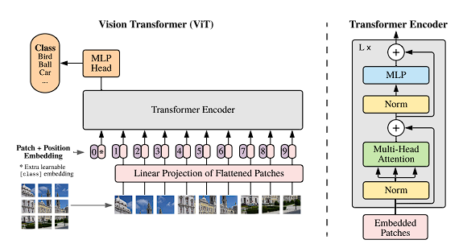

# Vision Transformer (ViT) - PyTorch

  

Implements **Vision Transformer (ViT)** based on the paper: [An Image is Worth 16×16 Words: Transformers for Image Recognition at Scale](https://arxiv.org/pdf/2010.11929)

The project aims to reproduce the core ViT architecture, exploring how standard Transformer encoders can be applied directly to image recognition tasks by treating image patches as input tokens.

**Paper:** Dosovitskiy et al., 2020